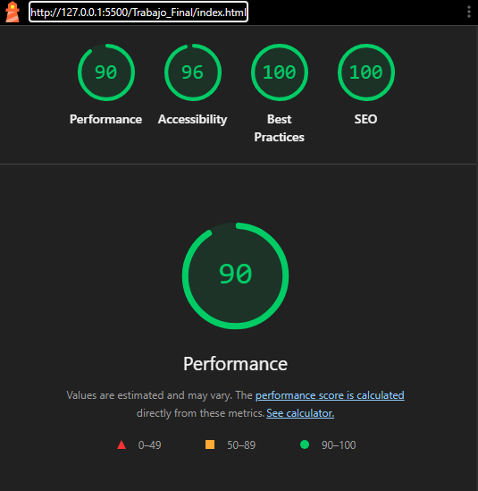
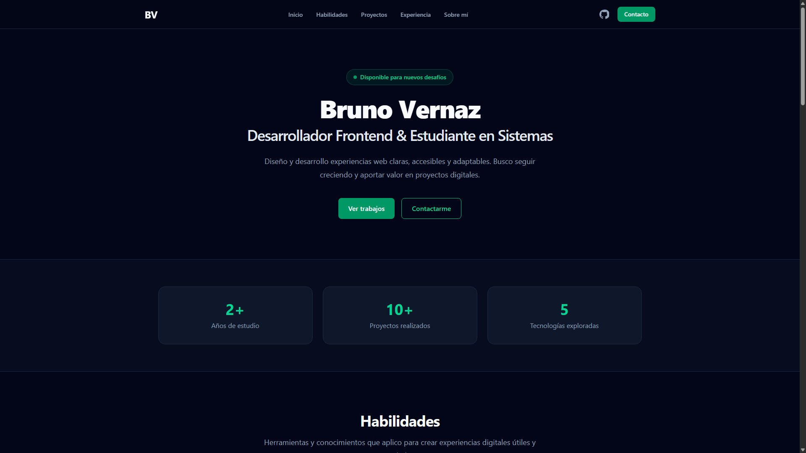

# Portfolio Web Personal - Trabajo Final UX/UI 🚀

## 🔗 Enlaces del Proyecto

- **🌐 Portfolio en producción:** [Ver sitio en Vercel](https://uxuiportfolio-azure.vercel.app)
- **🎨 Diseño UX/UI:** [Ver prototipo y Design System en Figma](https://www.figma.com/design/1EAbtJiyj2zFZ0rSx0Ggc2/Porfolio-prototype?node-id=0-1&p=f&t=okYuOEL4SuMsfRKq-0)

Este es el repositorio de mi Trabajo Final para la materia Diseño UX/UI (Licenciatura en Sistemas, UADER).

## 🛠️ Stack Tecnológico
* HTML5 Semántico
* Tailwind CSS v4 (vía CDN)
* Despliegue automático (CI/CD) mediante Netlify

## 🖼️ Foto de perfil

La imagen de la sección “Sobre mí” usa `object-fit: cover` y una posición personalizada (`object-position: 50% 25%`) para ajustar el encuadre sin modificar el archivo original.

## 📝 Declaración de uso de IA
Para la construcción de este proyecto, se utilizó GitHub Copilot estrictamente como asistente de maquetación y generación de código base en Tailwind CSS[cite: 17]. Todos los comandos de Git, la estructura de información, el diseño visual y las revisiones de accesibilidad fueron realizadas y validadas por el autor original del repositorio[cite: 17].

## 📸 Evidencias

